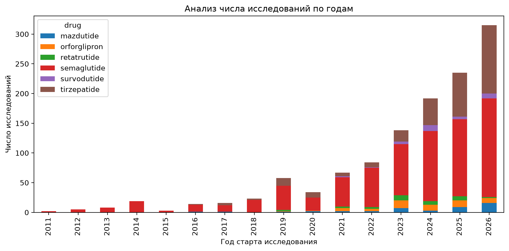
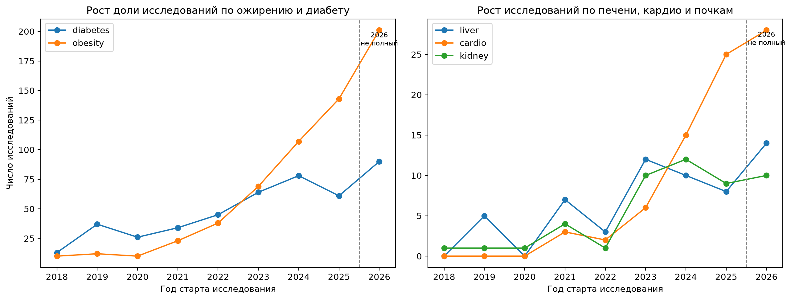
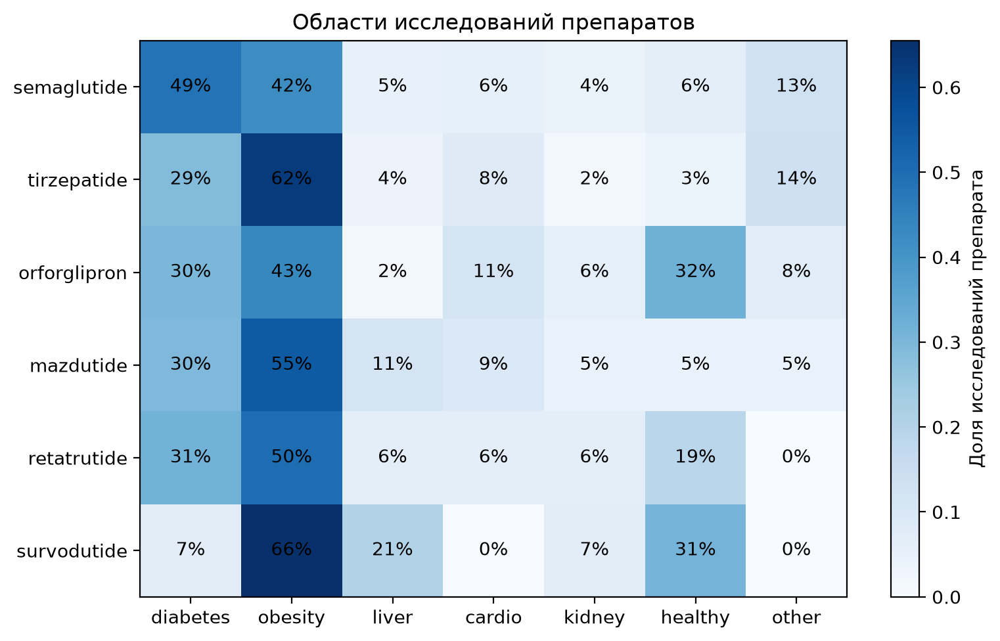
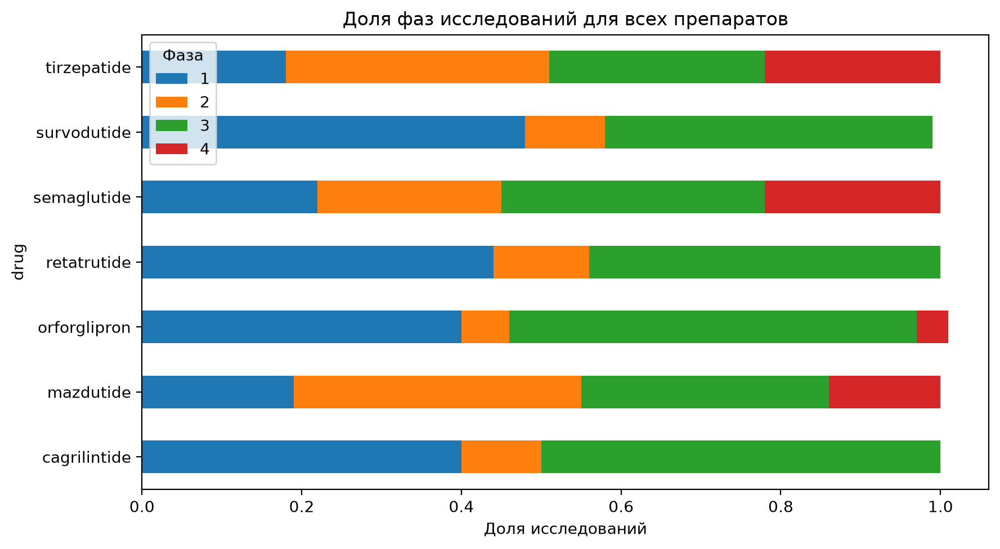
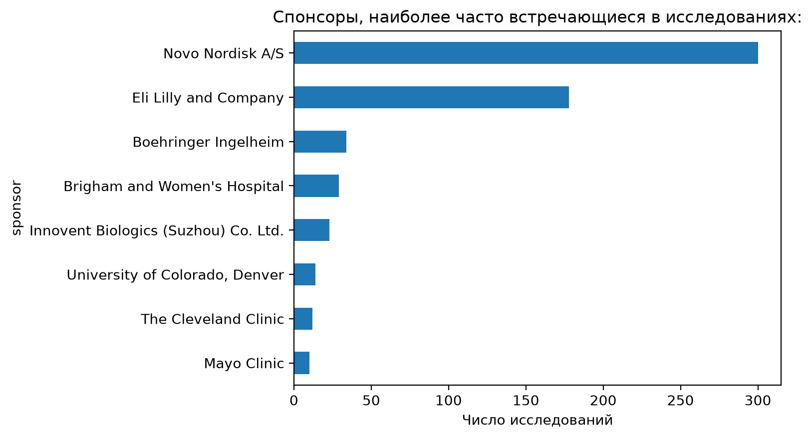

# GLP-1/GIP/GCGR агонисты: анализ клинической разработки

Как менялся фокус клинической разработки агонистов GLP-1/GIP/GCGR и кто её определяет? Проект анализирует открытые данные ClinicalTrials.gov и показывает динамику по годам, препаратам, показаниям, фазам и спонсорам. Это оценка активности разработки, а не размера рынка.

## Вопрос

Кто определяет клиническую активность по этим препаратам, когда она выросла и в какие показания расширяется?

## Данные

- Источник: ClinicalTrials.gov API v2, выгрузка 29.10.2026.
- Препараты (число найденных исследований): semaglutide (793), tirzepatide (308), orforglipron (53), mazdutide (44), retatrutide (33), survodutide (29). Всего 1260 строк.
- После очистки (без отозванных исследований, годы старта 2010–2026): 1213 исследований (semaglutide 759, tirzepatide 296, orforglipron 53, mazdutide 44, retatrutide 32, survodutide 29).

## Метод

1. Загрузка через API: `src/download.py`.
2. Разбор JSON в таблицу «одно исследование — одна строка»: `src/parse.py`.
3. Анализ и графики: `src/analysis.py` (запускается одной командой, сохраняет графики в `figures/`). Тот же анализ с пояснениями: `notebooks/analysis.ipynb`.
   - число стартов по годам и препаратам;
   - показания по ключевым словам в условиях исследования (диабет, ожирение, печень, сердечно-сосудистые, почки, здоровые добровольцы);
   - доли фаз (по наибольшей указанной фазе);
   - ведущий спонсор.

## Главные результаты

**1. Рост и концентрация.** Около 85% исследований стартовали с 2021 года. Semaglutide (62,6%) и tirzepatide (24,4%) дают около 87% всей активности, остальные четыре препарата вместе около 13%: orforglipron (4,4%), mazdutide (3,6%), retatrutide (2,6%), survodutide (2,4%).
*Рекомендация:* конкуренцию оценивать прежде всего по двум лидерам, а новые молекулы отслеживать по темпу роста.

**2. Показания.** Ожирение и диабет покрывают основную часть исследований, причём число исследований по ожирению растёт быстрее всего. Сердечно-сосудистые показания пока составляют небольшую долю, но растут, и значительная часть таких исследований одновременно относится к ожирению. Точные значения по годам см. на графике `figures/02_indications_by_year.png`.
*Рекомендация:* кардио анализировать вместе с ожирением, но следить за ним как за зарождающимся направлением.

**3. Профили препаратов.** Доли показаний (категории пересекаются):

| Препарат | Диабет | Ожирение | Печень | Кардио | Почки | Здоровые | Другое |
|---|---|---|---|---|---|---|---|
| semaglutide | 0,49 | 0,42 | 0,05 | 0,06 | 0,04 | 0,06 | 0,13 |
| tirzepatide | 0,29 | 0,62 | 0,04 | 0,08 | 0,02 | 0,03 | 0,14 |
| orforglipron | 0,30 | 0,43 | 0,02 | 0,11 | 0,06 | 0,32 | 0,08 |
| mazdutide | 0,30 | 0,55 | 0,11 | 0,09 | 0,05 | 0,05 | 0,05 |
| retatrutide | 0,31 | 0,50 | 0,06 | 0,06 | 0,06 | 0,19 | 0,00 |
| survodutide | 0,07 | 0,66 | 0,21 | 0,00 | 0,07 | 0,31 | 0,00 |

Semaglutide единственный, у кого диабет (49%) преобладает над ожирением (42%). У tirzepatide (62%), survodutide (66%) и mazdutide (55%) ожирение занимает больше половины исследований. Печень заметна у survodutide (21%) и mazdutide (11%); у survodutide 6 исследований по печени, из них 5 про MASH/NASH и 4 в фазе 3. Кардио максимально у orforglipron (11%) и mazdutide (9%). Высокая доля исследований на здоровых добровольцах у orforglipron (32%), survodutide (31%) и retatrutide (19%) говорит о ранней стадии разработки.
*Рекомендация:* в MASH следить за survodutide.

**4. Зрелость.** Фаза 4 есть у semaglutide и tirzepatide (по 22%), у остальных не выше 14%. Среди новых молекул самая высокая доля фазы 3 у orforglipron (51%); у survodutide и retatrutide почти половина исследований в фазе 1.
*Рекомендация:* ближайшим конкурентом лидерам считать orforglipron.

**5. Спонсоры.** Novo Nordisk и Eli Lilly остаются крупнейшими спонсорами (см. `figures/05_top_sponsors.png`). Доля ведущего спонсора по препаратам:

| Препарат | Ведущий спонсор | Исследований | Доля |
|---|---|---|---|
| survodutide | Boehringer Ingelheim | 28 из 29 | 97% |
| retatrutide | Eli Lilly and Company | 31 из 32 | 97% |
| orforglipron | Eli Lilly and Company | 49 из 53 | 92% |
| mazdutide | Innovent Biologics (Suzhou) | 19 из 44 | 43% |
| semaglutide | Novo Nordisk A/S | 252 из 759 | 33% |
| tirzepatide | Eli Lilly and Company | 81 из 296 | 27% |

Новые молекулы почти целиком принадлежат разработчикам. У зрелых препаратов доля ведущей компании ниже: остальное в основном исследования академических и клинических центров, которые запускают собственные работы, когда препарат уже доступен.
*Рекомендация:* для зрелых препаратов учитывать академическую активность как индикатор новых показаний.

## Графики







## Ограничения

- Регистр показывает заявки на исследования, а не результаты и не коммерческий успех.
- Поиск по названию препарата включает комбинированные схемы и исследования, где препарат выступает сравнением.
- У survodutide, retatrutide и mazdutide 29–44 исследования, поэтому доли ориентировочные.
- Категории показаний определены по ключевым словам и пересекаются: одно исследование может входить в несколько категорий.
- Фаза не указана примерно у четверти исследований (в основном без интервенционного дизайна).
- Год 2026 неполный, часть дат старта плановая.
- Фаза 4 не означает регуляторное одобрение; статусы нужно проверять в FDA/EMA.

## Как запустить

```
python -m venv .venv
.venv\Scripts\activate
pip install -r requirements.txt
python src/download.py
python src/parse.py
python src/analysis.py
```

`src/analysis.py` печатает ключевые числа и перезаписывает графики в `figures/`. Пояснения к анализу: `notebooks/analysis.ipynb`.

## Структура
- `src/` скрипты загрузки, разбора и анализа
- `data/clean/` итоговая таблица
- `notebooks/` анализ с пояснениями
- `figures/` графики
